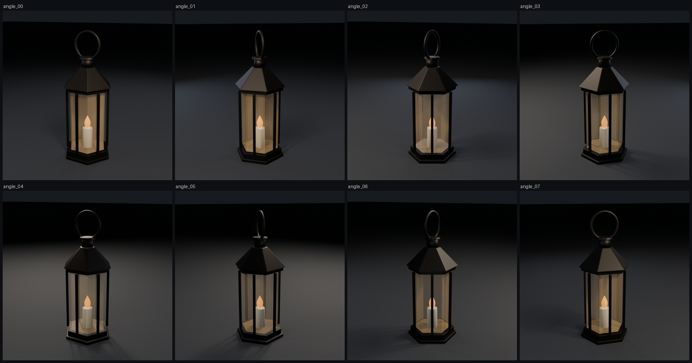

# Claude Blender Dev

A workspace where **Claude Code builds 3D models, game assets and short films in Blender**, then looks at the results and fixes them. It drives Blender in two ways:

- **Live:** a running Blender session, through the official [Blender Lab MCP server](https://www.blender.org/lab/mcp-server/).
- **Headless:** command-line Blender scripts that can be run again and give the same result.

Every result is checked against measurements and rendered images, so "the script ran" never counts as "done".

<p align="center"></p>

## What it does
- **Procedural assets from a single spec file.** Each `spec.py` holds the dimensions, colours, budgets and review history. Its `build.py` turns that into Blender geometry.
- **Validation against engine rules:**
  - triangle budgets;
  - materials per mesh;
  - transforms applied;
  - UVs in 0–1;
  - watertight geometry;
  - naming;
  - origin placement;
  - texture sizes.
- **Export presets:**
  - **Roblox (FBX):** settings from Roblox's official export docs; converts metres to studs (1 stud = 0.28 m).
  - **Web (GLB):** for three.js and general interchange.
  - **Unity / Unreal (FBX):** conventions only; see the caveats below.
- **Reimport check.** Every export is loaded back into a fresh Blender process. Mesh count, triangles, materials and scale must match the source.
- **Visual review loop:**
  - EEVEE turntable previews and contact sheets;
  - colour checks that compare rendered pixels with target hex values;
  - fixes written as exact numbers.
- **Film pipeline** (after Nate Herk's *Claude + Blender: Make 3D Motion Graphics From Code* playbook):
  - chunked, resumable renders;
  - Cycles on Metal or CUDA, or EEVEE;
  - a scan that finds black, white, flat, missing or corrupt frames;
  - ffmpeg encoding.
- **Claude Code integration:** four project skills, a `CLAUDE.md` with routing and safety rules, and permission `ask` rules for risky actions.

## Requirements
- macOS on Apple Silicon (tested on an M3 with macOS 27). Linux and Windows should work with path changes.
- [Blender](https://www.blender.org/download/) 5.1 or later. Tested on **5.2.3 LTS**.
- [uv](https://docs.astral.sh/uv/), Python 3.11+, ffmpeg (a full build), and git-lfs.
- [Claude Code](https://code.claude.com), for the AI-driven workflows. The scripts also run on their own.

## Setup
```bash
git clone https://github.com/dani-aisystems/claude-blender-dev.git && cd claude-blender-dev
git lfs pull
uv sync                                   # host tools: numpy, Pillow, pytest
tools/py -m pytest                        # 7 tests; the Blender ones need Blender installed
```

### Live Blender connection (optional)
These steps use the official Blender Lab MCP, which is GPL-3.0. It is **not** bundled here.
```bash
git clone --branch v1.0.3 https://projects.blender.org/lab/blender_mcp.git ~/blender_mcp
(cd ~/blender_mcp/mcp && uv sync)
# Add-on: download mcp-1.0.3.zip from the project's releases, then:
/Applications/Blender.app/Contents/MacOS/Blender --command extension install-file -r user_default -e mcp-1.0.3.zip
# Register with Claude Code for this folder only:
claude mcp add blender --scope local -e BLENDER_PATH=/Applications/Blender.app/Contents/MacOS/Blender \
  -- uv --directory ~/blender_mcp/mcp run blender-mcp
tools/launch_blender.sh                   # opens Blender and starts the bridge on localhost:9876
```
Restart Claude Code afterwards so it loads the `mcp__blender__*` tools.

## Quick start (headless)
```bash
tools/bl -P projects/models/hero_lantern/build.py -- --new --save          # -> hero_lantern_v00N.blend
B=projects/models/hero_lantern/hero_lantern_v005.blend
tools/bl $B -P scripts/validation/validate_asset.py -- --collection ASSET_hero_lantern --target roblox --json renders/v.json --strict
tools/bl $B -P scripts/exports/export_asset.py -- --collection ASSET_hero_lantern --name hero_lantern --targets roblox,gltf --out exports/hero_lantern
tools/bl $B -P scripts/render/preview.py -- --collection ASSET_hero_lantern --out renders/hero_lantern/preview
tools/py scripts/render/contact_sheet.py renders/hero_lantern/preview -o renders/hero_lantern/sheet.png
```
`tools/bl` wraps `blender -b --factory-startup`. `tools/py` runs the project venv's Python, because `uv run` fails when the folder path contains `:`.

## Layout
```
CLAUDE.md               Claude Code rules: precedence, skill routing, safety, completion criteria
.claude/skills/         blender-live · blender-asset-pipeline · blender-render-review · blender-film
.claude/settings.json   "ask" rules for deletes, downloads, installs, commits, writes outside the repo
projects/<type>/<name>/ spec.py (source of truth) · build.py · <name>_vNNN.blend (Git LFS)
scripts/lib/            args, path guards (no overwrite, stay in workspace), materials, bounds
scripts/exports/        presets.py (per-target settings + budgets) · export_asset.py
scripts/validation/     validate_asset.py · reimport_check.py · scan_frames.py · pixel_check.py
scripts/render/         preview.py · render.py (chunked) · gpu.py · turntable_scene.py · contact_sheet.py
scripts/film/           encode.py (ffmpeg)
tools/                  bl · py · launch_blender.sh · mcp_status.sh · fetch_cc0.py
docs/                   architecture, playbook compliance, workflows, troubleshooting, acceptance report
renders/ exports/       generated, gitignored
```

## Verified results
Full evidence is in [`docs/ACCEPTANCE_REPORT.md`](docs/ACCEPTANCE_REPORT.md).

- **Demo asset:** a hexagonal hand lantern with 4 meshes and 2,528 triangles.
- **Validation:** passes all rules for all four targets.
- **Reimport:** all four exports reimport with identical mesh count, triangles, materials and scale.
- **Visual review:** 4 measured fix rounds took the flame colour error from 145 to 76.
- **Film path:** a 24-frame turntable went through chunked render, frame scan (24/24 OK) and H.264 MP4 encode.

## Caveats (stated plainly)
- **Unity and Unreal presets are conventions.** The official engine docs give no Blender exporter settings, and neither engine was tested.
- **Roblox scaling needs a real-world check.** The metres-to-studs factor should be confirmed on your first Studio import.
- **The MCP has no real sandbox.** Blender Lab's own docs say the server executes model-generated Python "without any guards". This repo keeps the bridge on localhost, never auto-starts it, and adds rules against risky code. Generated code still runs with your user privileges, so a VM or a separate OS user gives stronger isolation.

## Credits
- **Method:** *Claude + Blender: Make 3D Motion Graphics From Code* by Nate Herk (AI Automation Society), building on rari's ([@0xwhrrari](https://x.com/0xwhrrari)) *Motion Engineering* prompt structure. The guide itself is not redistributed here.
- **Live connection:** [Blender Lab MCP server](https://projects.blender.org/lab/blender_mcp), GPL-3.0-or-later, maintained by the Blender Foundation.

## License
[MIT](LICENSE). Scripts written against Blender's Python API are combined with GPL software (Blender) when they run. MIT is GPL-compatible.
